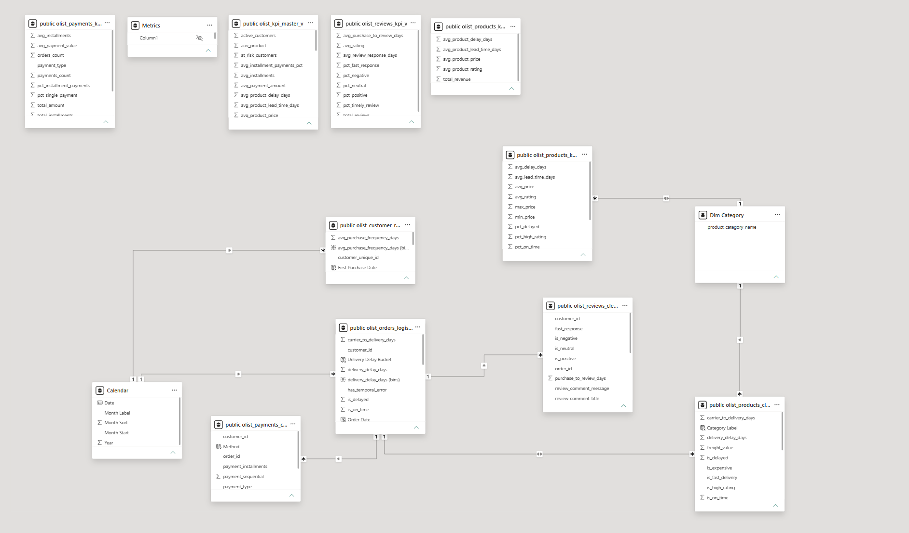
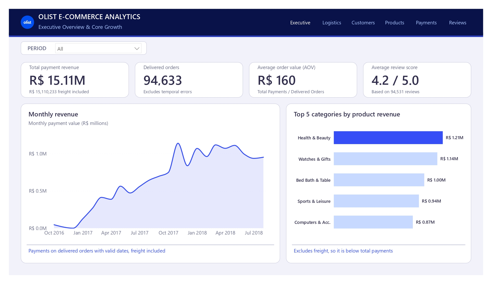
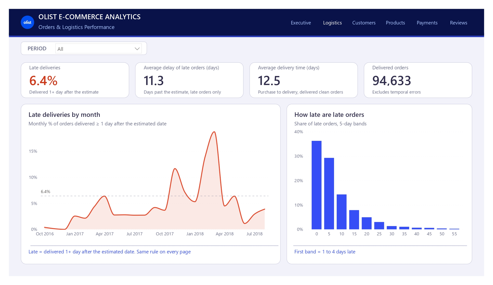

# Olist E-Commerce Analysis (SQL + Power BI)

A data analysis project on the public **Olist Brazilian E-Commerce** dataset from Kaggle:
https://www.kaggle.com/datasets/olistbr/brazilian-ecommerce

The dataset has about **100,000 real orders** from Brazilian marketplaces (2016-2018): order status, delivery times, prices, payment methods, reviews and customer location. I built a **PostgreSQL** pipeline that cleans the data and defines the KPIs, and a **6-page Power BI dashboard** with a period filter that shows them.


## Objectives
- Do the cleaning, aggregation and validation in **SQL**
- Define clear KPIs that can be reused
- Keep the business rules (what is "delivered", "clean" or "late") in SQL, and use Power BI to aggregate them so every number reacts to the period filter
- Build a dashboard that is easy to read and useful for business decisions


## Key figures (Oct 2016 - Aug 2018, delivered orders only)
| Metric | Value |
|---|---|
| Delivered orders | 94,633 |
| Total payments | R$ 15.11M |
| Average order value | R$ 160 |
| Average delivery time | 12.5 days |
| Orders delivered late (1 day or more) | 6.4% (11.3 days late on average) |
| Average review score | 4.2 / 5 (79.1% positive, 12.6% negative) |
| Unique customers | 93,358 (3% bought again) |

All amounts are in Brazilian reais (R$).


## What the data says
- **Growth leveled off after late 2017.** Monthly revenue grew fast through 2017 and has stayed around R$ 1.0M a month since. The data does not explain why.
- **Delivery time is the clearest driver of reviews.** Orders delivered in under 5 days score about 4.5 on average, while those that took around a month score about 2.7. This is a correlation, I did not control for category or seller.
- **Very few customers come back.** About 3% placed more than one order (about 2.2% if orders placed on the same day are not counted as a return), so growth depends on acquiring new customers.
- **Late deliveries come in waves.** The share of late orders stays low most of the time, with peaks in late 2017 and early 2018 (up to about 19% in a month).
- **Installments are common.** About half of the orders are paid in more than one installment, and bigger orders are spread over more installments.


## Technologies
- PostgreSQL 17
- Power BI Desktop
- Windows 11


## Project structure
```
Olist_Project/
├── data_kaggle/   # Original Olist CSV files (not included in the repository)
├── sql/           # SQL pipeline: schema, diagnostics, analyses, KPIs, quality checks
├── powerbi/       # Power BI project folder (.pbix available via external link)
├── docs/
│   ├── Olist_Ecommerce_Analysis.pdf   # PDF export of the report
│   ├── powerbi_model.png              # Data model (Model view)
│   ├── 01_executive.png
│   ├── 02_logistics.png
│   ├── 03_customers.png
│   ├── 04_products.png
│   ├── 05_payments.png
│   └── 06_reviews.png
└── README.md
```


## SQL architecture
The scripts run in order and build the data in layers:

`RAW tables` → `raw diagnostics` → `base views` → `clean views (_clean_v)` → `KPI views` → `kpi_master` → `quality checks`

| File | What it does |
|---|---|
| `00_schema`, `00_raw_diagnostics` | Raw tables with indexes and checks on the raw data |
| `01` customers | Retention on `customer_unique_id`, time between purchases with `LAG()` |
| `02` orders and logistics | Lead time, handling and shipping time, delays, KPIs by state |
| `03` products | Category KPIs, categories translated to English |
| `04` reviews | Positive / neutral / negative reviews, rating by delivery time |
| `05` payments | KPIs by payment method, installments |
| `06` sellers | Seller analysis (not shown in the dashboard) |
| `07_kpi_master` | One row with the main KPIs |
| `08_quality_checks` | Final data checks |

Main decisions:
- **Only delivered orders** are analyzed. A flag (`has_temporal_error`) removes orders whose dates are not in a logical order (for example purchase after approval, or delivery before the carrier pick-up). Orders without a delivery or estimated date are also left out. What remains is the "clean" set of 94,633 orders.
- **Late means 1 day or more after the estimated date.** This is the rule in the clean views (`is_delayed`) and in the dashboard (6.4%). Counting any delay above 0 days gives a higher rate, see "Known differences" below.
- **Retention uses `customer_unique_id`**, because Olist creates a new `customer_id` for every order.
- **Category names** are translated to English with a `LEFT JOIN` on the translation table. A category missing from that table keeps its original (Portuguese) name, and a product with no category is labelled "Unknown". Product revenue is the item price, without shipping.
- **Order-level rating** (subquery with `MAX`) avoids duplicating items.
- **Revenue vs product revenue.** Total payments (R$ 15.11M) is what customers paid, shipping included. Product revenue (R$ 12.95M) is item price only. They are different measures and should not be added up.


## Power BI data model


- **Fact table**: orders and logistics (clean view)
- **Related tables**: payments, reviews, products, customers, and the retention view (one row per customer)
- **Calendar table**: drives the period filter on all pages. A second relation links it to the first purchase date of each customer
- **KPI views** (`olist_kpi_master_v` and others): kept **disconnected** on purpose. I use them to check the dashboard numbers against the SQL numbers (the few differences are listed below)

DAX is kept simple: sums, counts, averages and a few ratios (for example the share of positive reviews and the share of orders paid in installments). The business rules stay in SQL.

### Known differences between the dashboard and the SQL summary views
The summary views are kept as they are. Where the dashboard computes a number differently, it is listed here:

| Topic | SQL summary view | Dashboard |
|---|---|---|
| Averages (price, rating, lead time, installments) | Average of the category or method averages | Average over item or payment rows |
| Customers base | All delivered orders | Customers page: all delivered orders. Other pages: delivered orders with consistent dates |
| Late orders | `olist_orders_delivered_kpi_global_v` counts any delay above 0 days and returns a fraction | Delay of 1 day or more, shown as a percentage |


## Dashboard
A period filter is synced on all six pages. Charts and cards react to the selected months.

| Page | What it shows |
|---|---|
| Executive | Revenue, orders, average order value, review score, revenue trend, top 5 categories |
| Logistics | Late orders, average delay, delivery time, delays over time and by days late |
| Customers | New customers by month, one-time vs repeat customers, time between orders (average days) for repeat customers who bought on different days |
| Products | Top 10 categories by revenue and their delivery time |
| Payments | Payments by method, orders paid in installments, average payment value |
| Reviews | Score distribution, positive and negative share, rating by delivery time |




More screenshots are in the `docs/` folder. A static PDF version is also available there.

The Power BI file can be downloaded here: [Download .pbix](https://drive.google.com/file/d/1BYSKC-0Dt-nKny-qMIh16yJJxt9JFxhw/view?usp=sharing)


## Design
- Colors come from the official **Olist design system** (design tokens): https://designsystem.olist.io
- Canvas 1280 x 720 (16:9). Margins of 32 px, gaps of 16 px, four KPI cards of equal width and two chart cards per page
- One accent color per chart. Green and red are used only for good and bad values
- Font: Segoe UI


## Limitations
- Public data from 2016 to 2018 for one marketplace. There are no costs, so no margin or profitability analysis
- The repeat rate is very small (3%) and depends on the definition. I count a customer as a repeat customer when they have more than one delivered order
- Orders placed on the same day count as separate orders. 786 of the 2,801 repeat customers (28.1%) placed all their orders on the same day, so they are split orders and not a return visit. The repeat rate on different days only would be about 2.2% instead of 3.0%
- The "Time between orders" chart leaves out those 786 customers. Of the other 2,015, about 28% (570) came back within 30 days on average when I counted distinct purchase days in SQL. The chart shows 29.3% in its first band: the small difference comes from customers who have orders both on the same day and on other days, whose average gap the chart calculates on timestamps. The data ends in August 2018, so recent customers had little time to buy again and the longer gaps are underrepresented
- In the Payments table an order can use more than one method (for example voucher plus card), so the rows add up to more than the total of paid orders
- The average payment in the Payments table (R$ 153) is per payment row, while the average order value (R$ 160) is per order, so the two differ
- The item rating is the review score of the order, repeated on each item, so orders with many items weigh more


## Reproducibility
1. Create a PostgreSQL 17 database (for example `olist`)
2. Run `00_schema.sql`. The setup notes at the top of the file explain two things the script does not do: creating `product_category_name_translation`, and removing the primary key from the two review tables (the reviews CSV repeats some `review_id` values)
3. Put the Olist CSV files in `data_kaggle/` and load them into the tables (header on, UTF8). Load the reviews file in full into both `order_reviews` and `order_reviews_full`
4. Run the other SQL scripts in order (`00_raw_diagnostics`, then `01` → `08`)
5. Check the database with a quick count: 94,633 clean orders, R$ 15,110,233 in payments, 94,531 reviews, 93,358 customers
6. Download the .pbix file from the link above and open it in Power BI Desktop. The data is already inside the file (import mode)
7. To refresh from your own database: *Transform data → Data source settings*, enter your server, database and credentials, then refresh

## Notes
- The dataset is not included in the repository
- Seller analysis is in the SQL (`06`) but not in the dashboard. In that view an order with more than one review repeats its items, so seller revenue can be slightly overstated
- Project made for a professional portfolio
